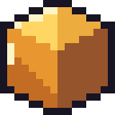
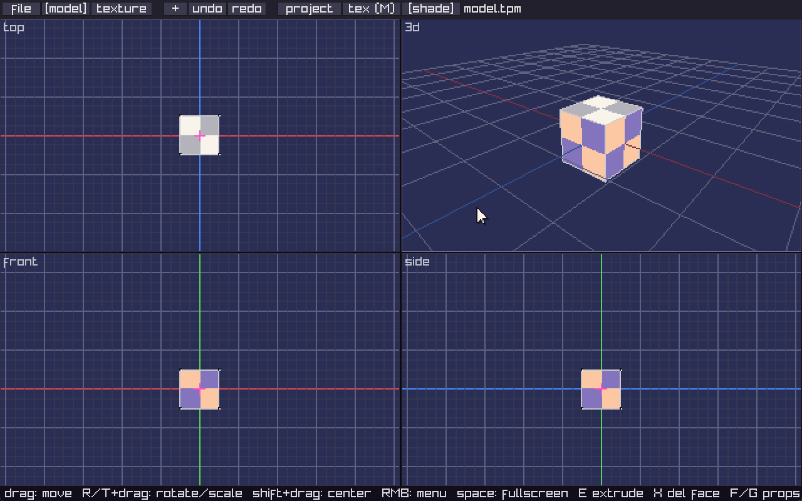
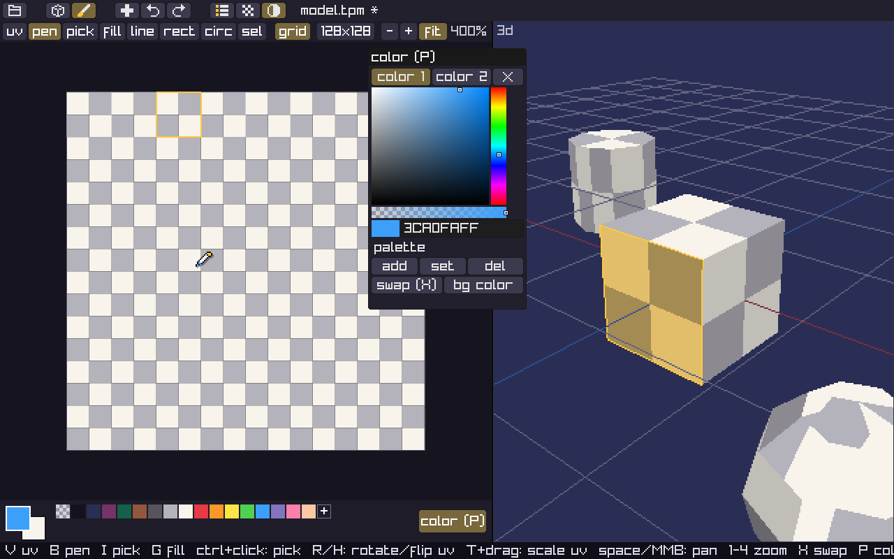
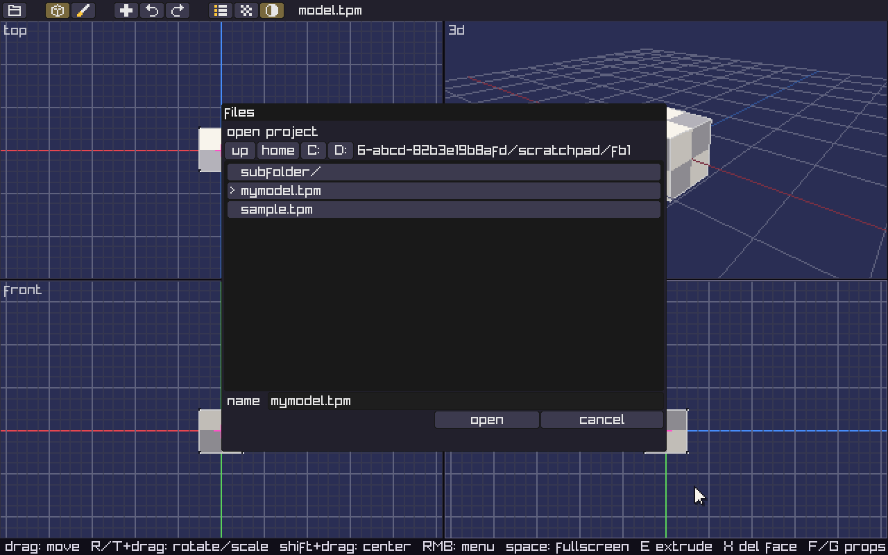
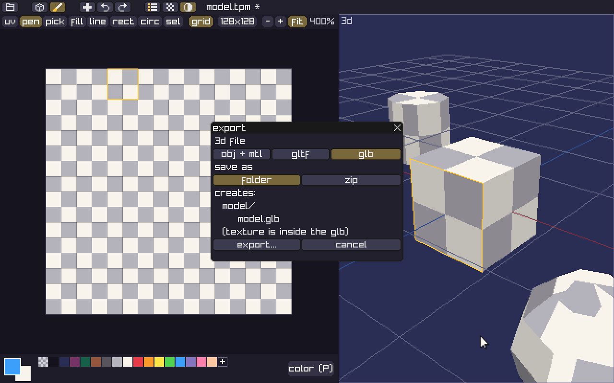
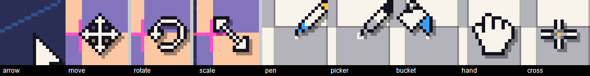

<div align="center">

**English** | [한국어](docs/README.ko.md)

<h1> TinyPoly</h1>

**A tiny, lightweight low-poly 3D modeler + pixel texture painter**

Build meshes by clicking and dragging in four views, paint textures up to 1024×1024 by hand,<br>
and export to OBJ / glTF / GLB.




</div>

---

## ✦ Features

### Modeling
- **Four views**: top / 3d / front / side. `Space` toggles fullscreen for the view under the mouse
- **7 primitives**: plane, cube, prism, pyramid, cylinder, cone, sphere. Right-click empty space to create one facing that view, or use the `+` button in the top bar
- **Click & drag editing**: drag a mesh or vertex to move it, `R`+drag to rotate, `T`+drag to scale, hold `Shift` while dragging to move the origin, `Ctrl` inverts grid snapping
- **Box select**: drag on empty space in the 2D views, `Ctrl`+drag in the 3D view (`Shift` adds to the selection)
- **Editing**: extrude faces, delete faces/vertices, merge and snap vertices, mirror, clone, copy/paste meshes
- **Selection bar**: select faces or vertices and a small bar appears at the bottom of the views, showing how many are selected and what you can do with them
  - faces: extrude, delete │ face color, options
  - vertices: merge, snap to grid, delete (merge is greyed out until 2+ vertices are selected)
- **Right-click menus**: the menu depends on what is under the cursor (vertex / face / mesh / empty space) and its title tells you which one it is
- **Face properties (`F`)**: color, double-sided, shading, textured, draw behind
- **Project window (`O`)**: hide (eye), lock (padlock), rename (double-click), center origin, clone, delete
- 3-step flat shading, transparent pixels, textured / color / wireframe render (`M`), shading toggle (`L`)

### Texture


- **RGBA textures, 128 to 1024**: change the size with the size button in the toolbar (the top-left pixels are kept)
- **Tools**: UV (`V`), pen (`B`), color picker (`I`), fill (`G`), line, rectangle, circle, area select. Click rectangle/circle again for the filled version
- **UV editing**: drag, move corners, rotate (`R`), flip (`H`), scale (`T`+drag), nudge with arrow keys, copy/paste
- **Area select**: move, copy/paste (`Ctrl+C/V`), delete (`Del`)
- **Color window (`P`)**: saturation/value square, hue bar, alpha, hex input. Separate colors for left and right click (`X` swaps them)
- **Palette**: up to 256 swatches. Add, overwrite, delete. The first swatch is transparent (eraser)
- Zoom from 12.5% to 3200%, or fit to window (`1` fit, `2` 100%, `3` 200%, `4` 400%)
- PNG import (up to 1024×1024, kept at its original size)

### Files


- Built-in file browser: looks and works the same on every OS
- Own format `.tpm` (text: meshes + UVs + texture (PNG) + palette). Older 16-color files from 0.4.x still open
- Drag and drop `.tpm` / `.png` files onto the window to open them

### Export


File → **export...** opens the export window. Pick a 3D format and how to save it (folder / zip), and it shows exactly which files will be created.

| Format | Files inside the folder or zip |
|---|---|
| OBJ + MTL | `name.obj` + `name.mtl` + `name.png` |
| glTF | `name.gltf` + `name.bin` + `name.png` |
| GLB | `name.glb` (texture included) |

Colors of untextured faces are stored in a strip at the bottom of the texture PNG, so they look the same in any engine.

### Interface
- Pixel-art icons everywhere. Hover for a moment to see the name and shortcut as a tooltip
- Pixel-rounded windows with a close button in the title bar, and a resize grip on resizable ones
- Short notifications (saved, errors) pop up in the bottom-left corner and fade out

### Pixel cursors


The cursor changes with what you are doing. The pencil tip and paint bucket show the current color, and the color picker's liquid shows the color under the cursor.

---

## ✦ Build

### Requirements
| Tool | Version / notes |
|---|---|
| CMake | 3.25 or newer |
| Ninja | the presets use `Ninja Multi-Config` |
| C compiler | C23 support (GCC 13+, Clang 17+) |
| raylib 5.5 | used if installed, otherwise CMake downloads and builds it |
| Git | needed when raylib is downloaded automatically |

<details>
<summary><b>Windows</b>: MinGW-w64 (GCC)</summary>

With [Scoop](https://scoop.sh) (PowerShell):

```powershell
scoop install git cmake ninja mingw
```

Or with winget:

```powershell
winget install Git.Git Kitware.CMake Ninja-build.Ninja BrechtSanders.WinLibs.POSIX.UCRT
```

Open a new terminal, check that `gcc --version` is 13 or newer, and run the [commands](#commands) below.
The executable ends up in `build\Windows\bin\Release\TinyPoly.exe`.

> MSVC (Visual Studio) has not been tested yet. Please build with MinGW GCC.
</details>

<details>
<summary><b>Linux</b>: packages needed to build raylib</summary>

```sh
# Debian / Ubuntu
sudo apt install build-essential cmake ninja-build gdb \
    libx11-dev libxrandr-dev libxinerama-dev libxcursor-dev libxi-dev libgl1-mesa-dev

# Fedora
sudo dnf install gcc cmake ninja-build gdb \
    libX11-devel libXrandr-devel libXinerama-devel libXcursor-devel libXi-devel mesa-libGL-devel

# Arch
sudo pacman -S --needed base-devel cmake ninja gdb \
    libx11 libxrandr libxinerama libxcursor libxi mesa
```
</details>

<details>
<summary><b>macOS</b></summary>

```sh
xcode-select --install
brew install cmake ninja
```
</details>

### Commands
```sh
cmake --preset default
cmake --build --preset release      # or debug
```

The executable ends up in `build/<OS>/bin/Release/TinyPoly` (`<OS>` is `Windows`, `Darwin` or `Linux`).

### VS Code
The included `.vscode` settings build and debug with **F5**. Pick the configuration for your OS in **Run and Debug**.
Debugging needs Microsoft's **C/C++ extension** (`ms-vscode.cpptools`); VS Code suggests it when you open the folder.

---

## ✦ Controls

### Modeling
| Input | Action |
|---|---|
| Click / drag | select, move |
| Drag empty space (2D) / `Ctrl`+drag (3D) | box select (`Shift` adds) |
| `R` / `T` + drag | rotate / scale |
| `Shift` while dragging | move the origin |
| Right-click | context menu |
| Right-drag | orbit (3D) / pan (2D) |
| Wheel / middle-drag | zoom / pan |
| `E` / `X` / `Del` | extrude / delete face / delete vertex |
| `F` / `G` | face / mesh properties |
| `Ctrl+C` / `Ctrl+V` / `Ctrl+X` | copy / paste / delete mesh |
| Arrow keys, WASD | move selection by one grid step (`Ctrl`: ¼ step) |
| `Space` | fullscreen the view under the mouse |
| `M` / `L` | render mode / shading |
| `Tab` | texture mode |

### Texture
| Input | Action |
|---|---|
| `V` `B` `I` `G` | UV, pen, color picker, fill |
| `Ctrl`+click | pick a color |
| Right-click | draw with the second color (menu with the UV tool) |
| `X` | swap left/right colors |
| `R` / `H` / `T`+drag | rotate / flip / scale UVs |
| Arrow keys, WASD | nudge UVs by one pixel |
| `Ctrl+C` / `Ctrl+V` / `Del` | copy / paste / delete (UVs or selected area) |
| `Space`+drag, middle-drag | pan |
| Wheel / `1`–`4` | zoom / fit, 100, 200, 400% |
| `Tab` | model mode |

**Everywhere:** `Ctrl+Z/Y` undo/redo, `Ctrl+S` save, `Ctrl+Shift+S` save as, `Ctrl+O` open, `O` project window, `P` color window

---

## ✦ Roadmap

- [ ] Animation timeline
- [ ] GIF / sprite sheet export
- [ ] Folders in the project window
- [ ] Warning when closing without saving
- [ ] Non-Latin file names (UI font)

---

## ✦ License

TinyPoly is released under the [MIT License](LICENSE).

Libraries used:

| Library | Used for | License | How it's included |
|---|---|---|---|
| [raylib](https://github.com/raysan5/raylib) 5.5 | window, input, rendering | zlib | downloaded by CMake at build time |
| [microui](https://github.com/rxi/microui) 2.02 | UI | MIT | vendored unmodified in `src/microui/` |

Copyright notices for each library are in [THIRD_PARTY_NOTICES.md](THIRD_PARTY_NOTICES.md).
